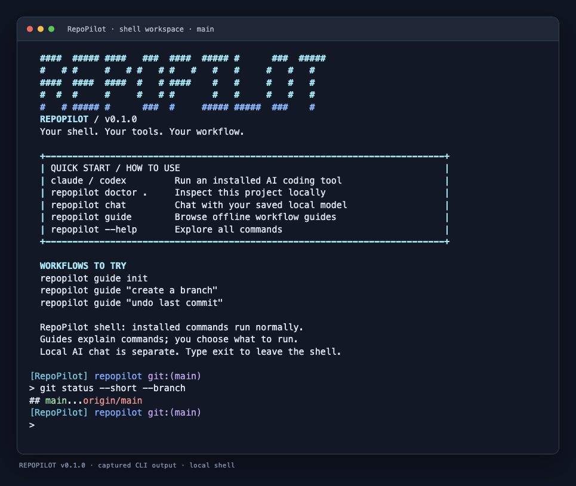
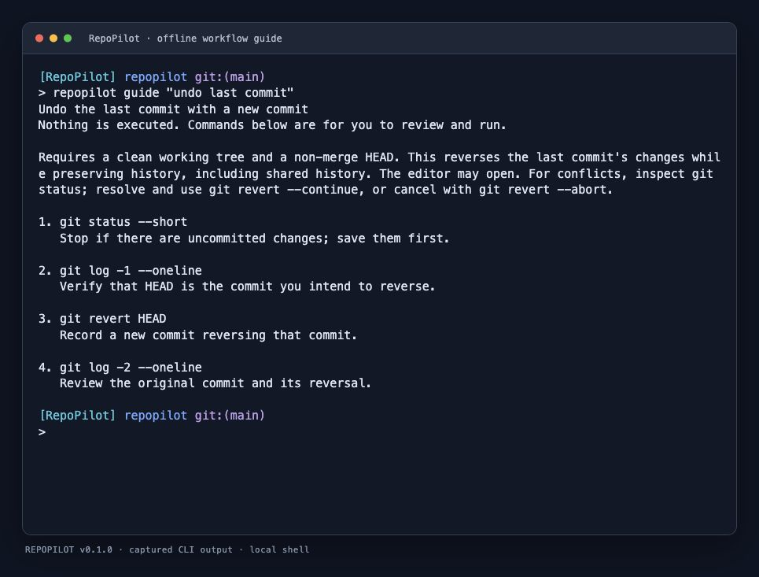

# RepoPilot

**Your real shell, useful offline project tools, and optional local AI chat.**

[](https://github.com/CharlieJamesGwapo/RepoPilot/actions/workflows/ci.yml)
[](LICENSE)

RepoPilot is a free, open-source developer CLI that opens your real shell, helps you understand a repository, and offers practical workflow guidance. Its core works locally without an account, backend, telemetry, or AI provider.

## Install

On macOS with Homebrew:

```sh
brew install charliejamesgwapo/tap/repopilot
```

The project's [third-party tap](https://github.com/CharlieJamesGwapo/homebrew-tap) selects the Apple Silicon or Intel binary. No Rust toolchain is needed. Shell completions and documentation are included; AI tools and models are installed separately.

[Download v0.3.0 binaries](https://github.com/CharlieJamesGwapo/RepoPilot/releases/tag/v0.3.0) for macOS, x86-64 Windows, and x86-64 Linux GNU. See [installation](docs/installation.md) for reviewed installers, checksums, PATH setup, and updates. Binaries are unsigned; macOS builds are not notarized.



*Captured from a real RepoPilot v0.1.0 PTY session, rendered with xterm.js. The welcome screen, Git prompt, and `git status` output are live CLI output; styling varies by terminal.*

## What you can do

| Capability | How it works |
| --- | --- |
| Use your real shell | Run installed commands such as `claude`, `codex`, and `git` with their own interfaces and authentication |
| See workspace context | Interactive zsh/bash prompt shows the folder, Git branch or detached commit, and a failed command's exit status |
| Understand a project | `scan`, `doctor`, and `explain` inspect local project evidence and environment signals |
| Review quality checks | `check` suggests commands for review; it does not run project scripts or tests |
| Find an offline workflow | `guide` covers init, branch, undo, status, stash, tools, and check |
| Produce reports | Export terminal, JSON, or Markdown output |
| Use optional chat | Plain `chat` uses configured local-only providers, with deterministic navigation available without AI |

RepoPilot runs inside your existing terminal emulator. Install and authenticate Claude, Codex, and other developer tools separately, then launch them normally from the RepoPilot shell.

## Start here

```sh
repopilot                              # Open your real shell here
repopilot scan .                       # Discover project structure
repopilot doctor .                     # Inspect environment and manifests
repopilot explain .                    # Read a deterministic summary
repopilot check .                      # Preview checks; execute nothing
repopilot guide "undo last commit"      # Read an offline workflow
repopilot report . --format markdown   # Produce a report
repopilot scan . --json                # Structured output for scripting
repopilot chat                         # Separate local-only chat interface
```

Inside the real shell, run your normal tools and type `exit` to leave. The branded zsh/bash prompt applies only to that session and loads normal shell configuration. Keep your own prompt with `repopilot shell --plain-prompt` or `REPOPILOT_PROMPT=off`.



*Actual PTY output from `repopilot guide "undo last commit"`, rendered in a terminal emulator. Guides explain commands and their consequences; they never execute them. Output may change between versions.*

## AI is optional

Plain `repopilot chat` uses saved user configuration in local-only mode. A supported loopback runtime must already be running. `/help`, `/scan`, `/doctor`, and `/explain` provide navigation and deterministic help; `/connect` guides supported provider setup. `/local` remains enabled for the session and blocks remote endpoints and process adapters.

Each AI request is independent: only the typed prompt is sent, with no automatic repository files or conversation history. Additional API and executable integrations use explicit configuration and consent. The supported mechanisms are a small chat-completions HTTP subset, loopback runtimes, and explicitly configured stdin/stdout executables. See the provider guide for compatibility and setup.

RepoPilot is free; external providers may charge for their services. Read [provider setup](docs/providers.md) and [privacy](docs/privacy.md) before connecting one.

## Built-in skills

The current source includes offline development and UI/UX skills you can inspect and export into a project:

```sh
repopilot skills list
repopilot skills show debugging
repopilot skills export debugging --path . --dry-run
```

Portable export is the default; Codex and Claude project layouts are optional. Exports include licenses, never overwrite an existing skill directory, and launch no agent. Included in v0.2.0 and later binaries and Homebrew installations. See [skills](docs/skills.md) for all ten workflows and export details.

## Local models, token controls and security

RepoPilot v0.3.0 includes optional [local coding-model presets](docs/local-models.md), [response budgets and measured provider usage](docs/token-controls.md), and security hardening. See the [release-readiness review](docs/release-readiness.md). These additions are included in **v0.3.0 binaries and Homebrew installations**. Offline work needs no model; model weights and runtime installation stay explicit.

## Learn more

- [User guide](docs/user-guide.md) — the full shell, diagnostics, guides, and chat workflow
- [Installation](docs/installation.md) — platforms, Homebrew, checksums, upgrades, and source builds
- [Command reference](docs/commands.md) and [troubleshooting](docs/troubleshooting.md)
- [Privacy](docs/privacy.md), [security boundaries](docs/security.md), and [security reporting](SECURITY.md)
- [Architecture](docs/architecture.md) and [provider adapter contract](docs/adapters.md)
- [Changelog](CHANGELOG.md) and [release process](docs/releasing.md)

## Build and contribute

With stable Rust and platform build tools installed, from this checkout:

```sh
cargo install --path . --locked
```

See [CONTRIBUTING.md](CONTRIBUTING.md) for checks and contribution guidance. Provider tests use mocks and local fixtures rather than paid API calls or real credentials. Streaming, automatic repository context upload, OS credential-store integration, and arbitrary plugin loading are not implemented.

Licensed under [MIT](LICENSE). Community participation follows the [Code of Conduct](CODE_OF_CONDUCT.md).
